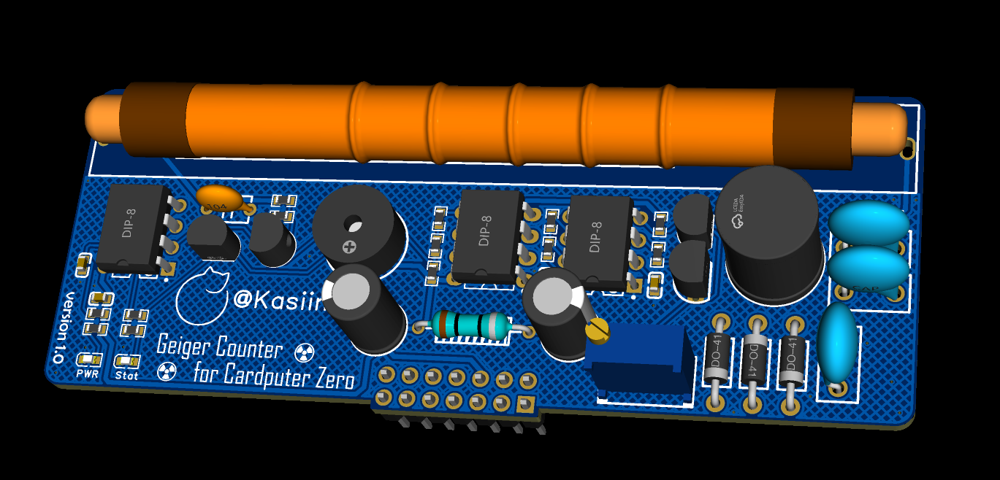

# Cardputer Zero Geiger Counter

用于 M5Stack Cardputer Zero 原厂 Linux APPLaunch 的盖格计数器。在 320×170 LCD 上显示上一完整秒的 CPS、最近 60 秒的 CPM、累计脉冲数和滚动柱状图。首次启动或清零后，CPM 会等待 60 秒完整采样。界面会提示内核事件队列丢失的边沿。

## 配套模块与接线

本 App 配合下图所示的 Cardputer Zero 盖格计数器扩展板使用。模块由顶部扩展口的 5VOUT 供电，并通过 G22 将检测到的脉冲送给 App 计数。



关机后改线。针脚号以 Cardputer Zero 官方 EXT 2.54-14P 图为准。

| 模块 | Cardputer Zero 顶部 EXT |
| --- | --- |
| 电源正极 | 6 脚，5VOUT |
| 电源地和脉冲地 | 4 脚，GND |
| 脉冲输出 | 5 脚，G22 / BCM GPIO22 |

5VOUT 默认关闭，开机后在 `Settings > ExtPort` 打开顶部 EXT 的 5 V 输出。

[M5Stack 官方引脚图](https://docs.m5stack.com/en/CardputerZero#ext-254-14p) · [M5Stack 扩展接口使用指南](https://docs.m5stack.com/en/compute/cardputerzero/usage#9-expansion-interfaces)

## 安装和使用

下载 [0.2.1-1 安装包](dist/cardputer-zero-geiger_0.2.1-1_all.deb) 并复制到设备。在设备上进入安装包所在目录，再安装或升级。

```sh
sudo apt install ./cardputer-zero-geiger_0.2.1-1_all.deb
```

回到 APPLaunch，打开 **Geiger Counter**。按 `R` 清零，按 `Esc` 或 `Q` 退出。安装包需要 Python 3 和 Debian 的 `python3-pil`，后者用于绘制字体、数字和趋势图。图形界面使用原厂 APPLaunch 的 Linux framebuffer，键盘使用 evdev。

## 管型与剂量单位

按 `T` 在 M4011 和 J305 之间切换。当前管型显示在右上角，选择会保存，首次启动默认使用 M4011。按 `U` 在中间读数栏依次切换 CPM、µSv/h、mSv/y、rad/h、mrad/h 和 µrad/h。屏幕以 `u` 表示微（µ）。切换管型或单位会立即用当前的 60 秒数据重新计算。

| 管型 | γ 换算系数（每 CPM 对应的 µSv/h） |
| --- | ---: |
| M4011 | 0.0065 |
| J305 | 0.0081 |

µSv/h = CPM × 管型系数。mSv/y 按当前剂量率持续 365 天外推。rad 系列按 γ 辐射权重为 1 换算，1 Gy = 100 rad。剂量读数是基于预设系数的估算，精度取决于管子和实际校准条件。首次启动或清零后需采满 60 秒。检测到 GPIO 边沿丢失时，屏幕显示 `MISSED PULSES`，剂量值会在连续获得 60 秒完整计数后自动恢复。

[J305 参考系数](https://github.com/nmrr/flipperzero-geigercounter/blob/main/flipper_geiger/flipper_geiger.c) · [M4011 校准实验](https://doi.org/10.3390/qubs6030027) · [NRC 辐射测量单位](https://www.nrc.gov/facilities-safety/radiation-protection/radiation-and-its-health-effects/measuring-radiation)

## 致谢

感谢 nmrr 的 Flipper Zero 盖格计数器项目提供参考。本项目借鉴了下降沿计数、CPS、滚动 CPM 和趋势图的设计，Cardputer Zero 版本使用 Python 和 Linux 设备接口独立实现。 [nmrr/flipperzero-geigercounter](https://github.com/nmrr/flipperzero-geigercounter)

软件按 [MIT 许可证](LICENSE) 发布。

## 构建和验证

在 Windows 或 Linux 的项目根目录执行。构建环境需要 Python 3.10+ 和 Pillow 10.1+。

```sh
python -B -m unittest discover -s tests
python -B build_deb.py
```

本地预览可运行 `python -B geiger.py --preview preview.png --tube J305 --unit usv/h`，输出 320×170 的模拟界面 PNG。
